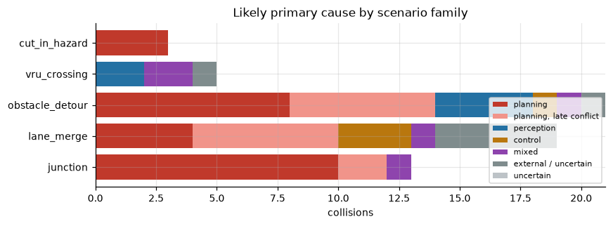
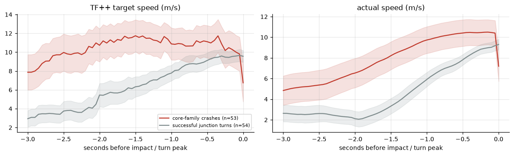
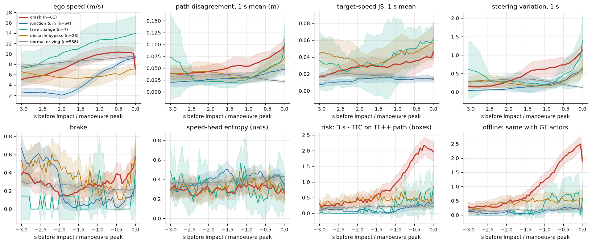
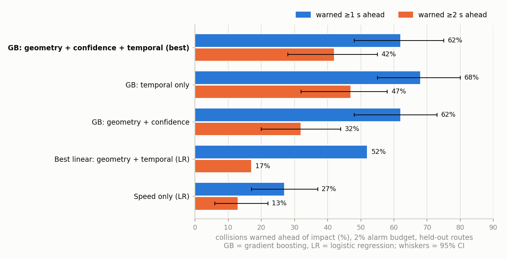
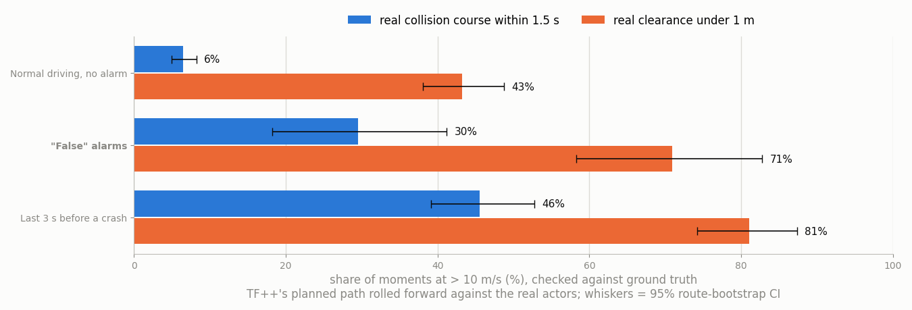
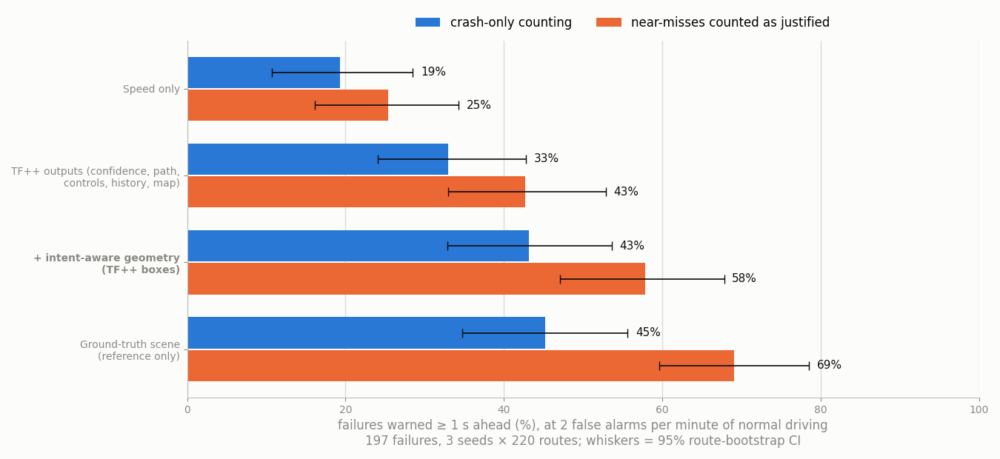

# Commit or Recover

**Research question:**

> Does temporal inconsistency in TransFuser++'s predicted paths, target-speed distributions, and control outputs provide earlier and more selective warning of closed-loop driving failures than instantaneous geometric checks or single-frame confidence measures?

## 1. Background

[TransFuser++ (TF++)](https://github.com/autonomousvision/carla_garage) is a pretrained end-to-end driving policy for CARLA. It runs at 20 Hz and has three stages. Only the first two are learned.

| Stage | How it works | Output used in this study |
|---|---|---|
| **Perception** (neural network) | Camera and LiDAR are encoded by two CNN backbones (RegNetY-032) and fused by a transformer into a bird's-eye-view (BEV) feature map. Auxiliary heads predict BEV semantics, depth and image segmentation during training; a CenterNet-style head detects other actors | **Bounding boxes**: position, size, heading, class and score for each detected actor |
| **Planning** (neural network) | A transformer decoder reads the fused features. A GRU decoder predicts the path, and a classifier predicts the target speed | **Planned path**: 10 waypoints, about 11 m ahead. **Target-speed distribution**: probabilities over 8 classes from 0 to 20 m/s |
| **Control** (rule-based) | A PID controller steers along the planned path. A fixed rule sets throttle or brake from the target and current speed. Hand-written overrides handle creeping when stuck, a LiDAR safety box and stop signs | **Steering, throttle and brake** |

TF++ stays **frozen** throughout. The question is whether its outputs, watched over time, warn that a collision is coming.

**Data.** All 220 Bench2Drive routes, run once in CARLA 0.9.15. 61 of 219 routes failed. **60 collisions** have a clean 3 s history and are used for prediction. The work focuses on three scenario families: junction turns, merges and obstacle detours. Finding 7 also uses a larger rerun: all 220 routes × 3 traffic seeds (659 route runs, **197 failures**) with the same logging.

**Logging ("schema v2").** A custom logger records every step; the full field list with a sample record is in [tfpp_sample_output_v2.md](tfpp_sample_output_v2.md).
- **TF++ outputs:** planned path, full target-speed distribution, predicted boxes, and controls (steering, throttle, brake, plus which override was active);
- **Ego state and route:** speed, yaw rate and the next route target;
- **Ground truth, for labels and diagnosis only:** every CARLA actor within 60 m, and collision events with their exact CARLA frame.

The first logging version (v1) had no boxes, no ground-truth actors and no exact collision timing. Without those, it could not show whether TF++ had seen the actor it hit, or when the collision happened.

**Evaluation.**
- A step is labelled positive if a collision follows within 3 s.
- Every monitor is compared at the same **alarm budget**: its threshold is set so it is in alarm for 2% of normal driving, about 1.5–2 false alarms per minute.
- The main metric is **warned ≥1 s / ≥2 s**: the share of collisions with an alarm at least 1 s (or 2 s) before impact.
- Cross-validation is grouped by route, so test routes are never seen in training. Intervals are 95% route-bootstrap.

**Intent-aware geometry**, the term used below: TF++'s *planned* path, timed by its target speed, checked against TF++'s own detected boxes, which are tracked over time. It gives time-to-collision, minimum clearance and a conflict flag.

---

## 2. Main findings

### Finding 1: TF++ crashes are mostly planning failures

| Likely primary cause | Share of collisions |
|---|---|
| **Planning**: the actor was detected, the car followed its plan, and the plan ran into the actor | **64%** |
| Perception: construction props and pedestrians | 10% |
| Control: lag in high-speed lane changes | 7% |
| Mixed / external | 19% |

TF++ detects nearby moving vehicles 99% of the time. The actor it later hit was boxed 98% of the time 1 s before impact. Its controller follows the plan to within about 0.02 m.

### Finding 2: The failure is confident commitment, not instability

In the 3 s before a crash:
- TF++'s target speed **rises** (median 8.1 → 10.1 m/s);
- its path follows the route;
- in about **half** the crashes, its own plan checked against its own boxes shows the conflict **≥1 s ahead**, and it does not slow down.

It misjudges *when* it is safe to go. This is a gap-acceptance and timing failure.

*Target speed (left) and actual speed (right) before crashes (red) vs successful junction turns (grey).*

### Finding 3: Instability signals do not separate crashes from successful manoeuvres

AUROC for junction crashes against successful junction turns, where 0.5 is chance and below 0.5 points the wrong way:

| Signal | AUROC |
|---|---|
| Intent-aware geometric risk | **0.80** |
| Target-speed JS divergence | 0.64 |
| Path disagreement | 0.28 |
| Steering variation | 0.15 |
| Path end-point jitter | 0.04 |

**Successful turns are *less* stable than crashing ones.** Path disagreement, speed-distribution change and steering variation rise before crashes, but just as much during successful manoeuvres.

*Only the geometric risk on TF++'s planned path (bottom row, third panel) rises clearly and only before crashes (red).*

### Finding 4: The simple temporal baseline does not beat speed; intent-aware geometry does

Logistic regression, at the 2% alarm budget:

| Monitor | AUPRC | Warned ≥1 s | Warned ≥2 s |
|---|---|---|---|
| Speed only | 0.10 | 27% | 13% |
| TF++ confidence (single frame) | 0.10 | 27% | 15% |
| Temporal features (path disagreement, speed-distribution divergence, control variation) | 0.12 | 32% | 18% |
| Intent-aware geometry | **0.21** | 42% | 12% |

- **Only geometry is significantly better than speed.**
- The temporal features and TF++'s own confidence are not significantly better than speed.
- Geometry that ignores TF++'s plan (constant velocity) is much weaker: 28% of crashes flagged ≥1 s ahead, against 52% with the plan.

### Finding 5: Best predictor so far, and where temporal history helps

The best model is **gradient boosting** on intent-aware geometry, TF++ confidence and about **1 s** of temporal features.

| Model (2% budget) | AUPRC | Warned ≥1 s | Warned ≥2 s |
|---|---|---|---|
| **Gradient boosting: geometry + confidence + 1 s history** | **0.36** | 62% | 42% |
| Gradient boosting: geometry + confidence, no history | 0.31 | 62% | 32% |
| Best linear model | 0.22 | 52% | 17% |
| Speed only | 0.10 | 27% | 13% |

- **History adds lead time, not detection.** Adding 1 s of history leaves ≥1 s recall unchanged and adds **+10 points [+2, +19] of ≥2 s warnings**. This is the only significant temporal gain.
- **Short history is enough.** Results peak at 0.5–1 s; 2–3 s does not help.
- **Model choice matters more than history length.** A non-linear model on the same features gains far more than any change in history.
- A GRU over 3 s of outputs did not beat these models with only 60 collisions.

### Finding 6: Very early warning is rare, and data is the main limit

- At a strict budget (about 1 false alarm per minute), no monitor warns ≥2 s ahead on more than 17% of collisions. A reference that uses ground-truth actor positions does no better.
- TF++'s planned path reaches only about 1 s ahead at typical speeds, which limits how early its plan can show a conflict.
- 60 collisions give confidence intervals of about ±12 points.

### Finding 7: About half of the "false alarms" are near-misses

The label "collision within 3 s" counts every alarm without a crash as false. That includes alarms during real hazards that resolved by luck: the other car braked, or TF++ corrected just in time. Each alarm in normal driving was therefore checked against the ground truth. An alarm is **justified (a near-miss)** if, while it is on or within 1 s of it starting, TF++'s planned path rolled forward against the *real* actors gives a time to collision under 1.5 s. This is the ground-truth version of intent-aware geometry; it is used only for evaluation, never as a monitor input.

*Data: 3 seeds × 220 routes (659 route runs, 197 failures). Gradient boosting, route-grouped cross-validation, alarm score smoothed over 0.5 s. Monitors are compared at the same number of false-alarm onsets per minute of normal driving.*

**High-speed "false" alarms look like the moments before crashes, not like normal driving.** At ego speed above 10 m/s, the share of moments where TF++'s plan was on a real collision course within 1.5 s:

| Moment | Collision course within 1.5 s | Real clearance under 1 m |
|---|---|---|
| Normal driving, no alarm | 6% [5, 8] | 43% |
| **"False" alarms** | **30%** [18, 41] | **71%** |
| Last 3 s before a crash | 46% [39, 53] | 81% |

**Counting near-misses as justified alarms**, at 2 false alarms per minute:

| Monitor | Warned ≥1 s, crash-only counting | Warned ≥1 s, near-miss counting | Alarms that were near-misses |
|---|---|---|---|
| Speed only | 19% | 25% | 31% |
| TF++ outputs (confidence, path, controls, 1 s history, map) | 33% | 43% | 40% |
| **+ intent-aware geometry (TF++ boxes)** | **43%** | **58%** | **51%** |
| Ground-truth scene (reference only) | 45% | 69% | 56% |

- **About half of the best monitor's "false alarms" were real hazards.** Crash-only labels underestimate the monitor and overstate the false-alarm problem.
- **This is why direct false-alarm fixes stall.** Manoeuvre-aware thresholds, hard "box near the plan" gates and speed-normalised features gave no significant gain (Section 3): many of the alarms they try to remove are correct.
- **The value of intent-aware geometry grows under this counting.** Paired route-bootstrap, with vs without TF++ boxes at 2 false alarms per minute: **+15 points [+7, +24] warned ≥1 s** and **+11 points [+3, +19] warned ≥2 s**. Under crash-only counting: +10 [+1, +19] and +0 [−7, +6].
- **Robust to the cutoff.** With the box monitor at 2 false alarms per minute, warned ≥1 s is 47% with a 1.0 s near-miss cutoff and 68% with 2.0 s. Boxes win at every cutoff.

**Caveats.** The near-miss definition is the ground-truth version of intent-aware geometry, so monitors that use geometry are partly rewarded for agreeing with it, and the ground-truth reference row is fully circular. Crash-only and near-miss numbers should always be reported side by side. "Near-miss" means "on a collision course with the actors' current motion" (constant velocity), not "a crash was certain". Thresholds in this analysis were set on all data rather than on validation routes, which affects compared monitors equally but makes absolute rates slightly optimistic.

### Side check: would a timely slow-down avoid the crash?

On 6 crash routes, speed was capped at 5 m/s around the known impact time. This oracle check shows what an ideal warning could buy. The crash was avoided in **2**; in **4** it was only postponed and the car hit another vehicle later.

| Case | Route | Video (original vs capped) |
|---|---|---|
| Avoided | 25424 | [route_25424_crash_avoided_raw_vs_cap5mps.mp4](oracle_videos/route_25424_crash_avoided_raw_vs_cap5mps.mp4) |
| Postponed | 2084 | [route_2084_crash_postponed_raw_vs_cap5mps.mp4](oracle_videos/route_2084_crash_postponed_raw_vs_cap5mps.mp4) |

---

## 3. Negative results

- Instability does not mark crashes: successful junction turns are less stable than crashing ones.
- The simple temporal baseline and TF++'s own confidence are no better than ego speed. At junctions, confidence and speed are worse than chance.
- Target-speed entropy carries almost no warning.
- History longer than 1 s does not help.
- TF++'s box speed field is always 0, so actors must be tracked frame to frame.
- Pedestrian detection is poor (38% recall), so pedestrian crashes are outside what an output-level monitor can catch.
- Separate alarm thresholds per context (junction or not × 4 speed bands) catch slightly more crashes per second of alarm time, but split alarms into more pieces; at the same false alarms per minute they lose to one global threshold.
- Hard scene gates ("alarm only if a TF++ box is near the plan") and speed-normalised features (time headway, time to reach the nearest box along a plan extended to 50 m) add nothing once intent-aware geometry is a model input.
- What does help against brief false alarms: smoothing the alarm score over 0.5 s cuts false-alarm onsets about 3× at the same alarm time, raising warned ≥1 s from about 30% to 43% at about 3 false alarms per minute.

---

## 4. Next steps

**The main open problem is false alarms, but about half of them are near-misses** (Finding 7). At the 2% budget the best model raises about **3 false alarms per minute**, mostly short (about 0.5 s) and mostly during legitimate turns, lane changes and bypasses. The target should be *unjustified* alarms, reported next to crash-only numbers. The plan is to bring the false-alarm rate down by an order of magnitude, to roughly one per 5–10 minutes, while keeping as much ≥1 s recall as possible.

1. **More failures and more normal driving.**
   - Analyse the 36 Longest6 routes already logged.
   - Rerun the three core families with more seeds and parameterised variants. The target is 150–200 collisions.
   - More data matters most at strict budgets, where the current 60 collisions are too few to set thresholds reliably.
   - Done in part: 3 seeds × 220 routes (659 route runs, 197 failures) are now logged with schema v2.
2. **Reduce false alarms directly.**
   - **Alarm persistence:** done. A 0.5 s smoothing of the alarm score works best; requiring 5–10 consecutive steps does worse at the same false-alarm rate.
   - **Manoeuvre-aware thresholds:** done, no gain (Section 3).
   - **Near-miss-aware evaluation:** count alarms during ground-truth hazards as justified (Finding 7), and rerun it with thresholds chosen on validation routes.
   - **Better geometry:** extend TF++'s short (about 11 m) planned path, improve box tracking, and fix flipped headings. Cleaner conflict estimates should mean fewer spurious alarms.
   - **Graded alerts:** a low-level "caution" signal and a stricter "alarm", instead of one threshold.
3. **Report at strict budgets.** Evaluate at 0.5% and 1% as well as 2%, as false alarms per hour and recall–lead-time curves, so the trade-off is visible.
4. **Confirm the best model:** run 3 seeds with tuning, and evaluate on held-out scenario families as well as held-out routes.

## 5. Questions

1. **Contribution.** The original hypothesis (temporal instability predicts failure) is not supported. The evidence instead shows that TF++ fails by confident commitment, which is caught by checking its intent against its own perception. Is a negative result on instability plus this reframed positive result a sufficient research contribution? Given existing trajectory-hazard monitors, where should the novelty be argued?
2. **Operating point.** For a warning-only monitor, how should the trade-off between false-alarm rate and lead time be judged? Is there an accepted target false-alarm rate, or is reporting the full recall–false-alarm–lead-time trade-off the more defensible evaluation?
3. **What to predict.** The oracle check shows that many crashes are only postponed by an early slow-down. Should the prediction target stay "collision within 3 s", or move towards "avoidable collision" or a point of no return, which ties the prediction more closely to safety value? Finding 7 suggests a third option: a **hazard label** (ground-truth time to collision on the plan under 1.5 s), which counts near-misses as positives and gives many more training examples than crashes alone. Is that defensible, given that it is partly circular with intent-aware geometry?
4. **Offline vs closed-loop evidence.** How much safety value can be claimed from offline prediction results alone? Is a limited closed-loop demonstration needed to support the conclusions?
5. **Generality.** All results come from one frozen TF++ checkpoint on Bench2Drive. How far can the finding that an end-to-end policy "fails by confident commitment" be generalised? Is a second checkpoint or policy needed to make that claim?
